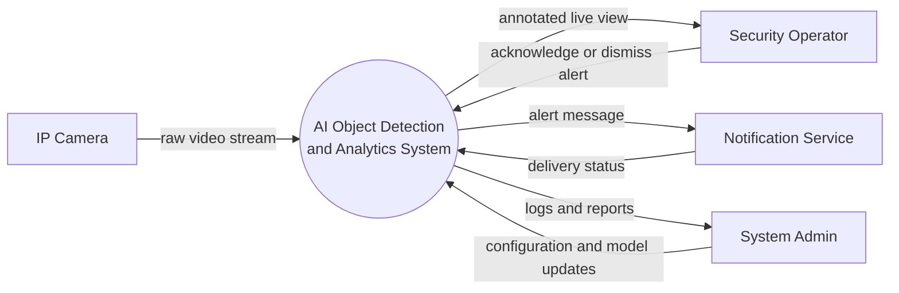
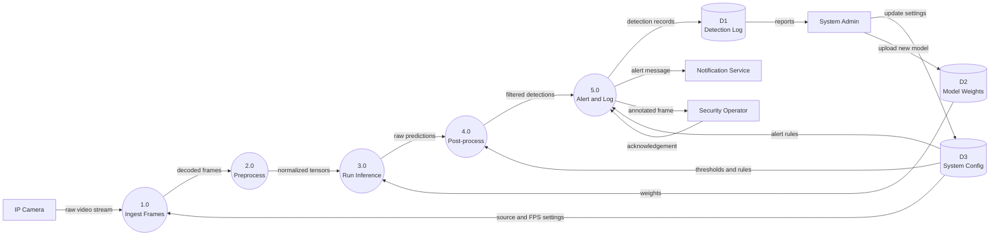
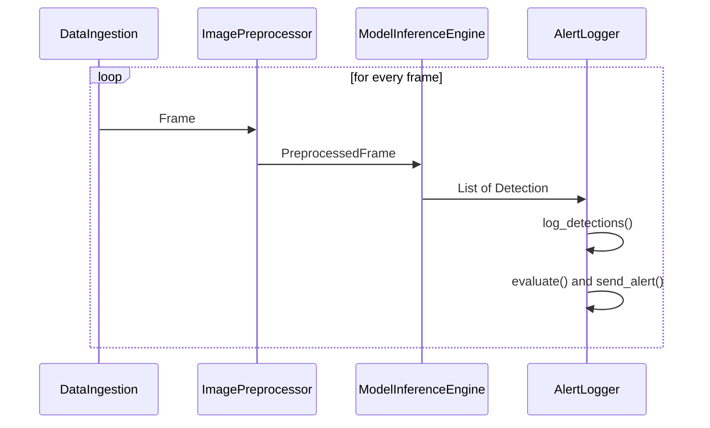

# System Design Specification: AI Vision System

**Course:** AI Project Design and Development (AI-316)
**Lab:** 02 – System Requirements & Software Architecture for AI Projects
**Student:** Mahad | **Roll No:** 231242
**Department of Creative Technologies, Air University Islamabad**

---

## 1. Overview

This document covers the requirements and architecture for a camera-based computer vision system. Following the lab tasks, it uses two example setups that share one pipeline:

- a **Smart Automated Attendance System** (Section 2), used to practice writing requirements, and
- an **AI-powered surveillance and object detection system** (Sections 3 to 5), used for boundary mapping, data flow, and the module design.

Both follow the same flow: camera → preprocessing → model inference → post-processing → logging/alerts.

---

## 2. Requirements (Smart Automated Attendance System)

### 2.1 Functional Requirements

| ID | Requirement | Acceptance Criteria | Priority |
|----|-------------|---------------------|----------|
| FR-01 | Detect faces in the live camera feed | Face detected and localized in under 200 ms per frame | High |
| FR-02 | Recognize each detected face against enrolled students | Matches a student ID, or labels the face "unknown" if confidence is below threshold | High |
| FR-03 | Log attendance with student ID, timestamp, and class session | One record per student per session; repeat sightings do not create duplicates | High |
| FR-04 | Sync attendance records to the central database | Records appear in the database within 60 seconds of capture; unsent records are queued when offline | Medium |
| FR-05 | Let an instructor view and correct attendance | Instructor can mark a student present/absent manually; every change is saved with the editor's name and time | Medium |

### 2.2 Non-Functional Requirements

| ID | Category | Requirement | Target |
|----|----------|-------------|--------|
| NFR-01 | Performance | Minimum processing frame rate on the edge device | ≥ 10 FPS |
| NFR-02 | Accuracy | Face recognition accuracy on the validation set | ≥ 95% (false-accept rate ≤ 1%) |
| NFR-03 | Resource usage | Edge device power draw during continuous operation | ≤ 15 W |
| NFR-04 | Privacy & security | Face images are not stored after matching; face embeddings and records are encrypted at rest | 100% of stored data encrypted |
| NFR-05 | Reliability | System keeps running through short network or camera dropouts | Uptime ≥ 99% during class hours; auto-reconnect within 10 s |

---

## 3. System Boundary, Actors, and Input/Output Specification (Surveillance System)

### 3.1 Actors

| Actor | Type | Role |
|-------|------|------|
| Security Operator | Human | Watches live feed and alerts, confirms or dismisses incidents |
| System Admin | Human | Configures cameras, thresholds, alert rules; manages models and users |
| IP Camera | External device | Supplies the video stream |
| Notification Service | External system | Delivers alerts (SMS, email, or push) to operators |
| Automated Trigger (Scheduler) | System | Starts/stops monitoring on a schedule and runs log cleanup |

### 3.2 Inputs

| Input | Format / Source | Parameters |
|-------|-----------------|------------|
| Video stream | RTSP (H.264) from IP camera | 1920×1080 source, 15–25 FPS |
| Model weights | File on local disk | Detector weights (e.g., ONNX/PyTorch), loaded at startup |
| Configuration | YAML/JSON file | Confidence threshold, NMS threshold, alert classes, cooldown time |
| Operator commands | Dashboard / CLI | Start, stop, change camera, acknowledge alert |

### 3.3 Outputs

| Output | Format | Content |
|--------|--------|---------|
| Bounding boxes | List of (x1, y1, x2, y2) in pixels | One box per detected object, original-frame coordinates |
| Class labels and scores | String + float (0–1) | Object class and detection confidence |
| Annotated frames | Image / video overlay | Frame with boxes drawn, shown on the dashboard |
| Alert notifications | Message | Camera ID, time, object class, snapshot |
| Log entries | Database rows | Frame ID, timestamp, source, label, confidence, box |

### 3.4 Operational Constraints

| Constraint | Limit |
|------------|-------|
| Memory footprint | ≤ 4 GB RAM total for the pipeline |
| Bandwidth | ≤ 8 Mbps per camera stream |
| Inference latency | ≤ 100 ms per frame on the target device |
| End-to-end alert delay | ≤ 3 seconds from event to notification |
| Storage | Log database kept to 30 days, then purged |
| Scope boundary | Detection and alerting only; no identity tracking across cameras and no cloud video upload |

---

## 4. Data-Flow Diagrams

### 4.1 Level 0 (Context Diagram)



### 4.2 Level 1 DFD



**Process summary**

| Process | Input | Output |
|---------|-------|--------|
| 1.0 Ingest Frames | RTSP stream | Decoded frames with ID and timestamp |
| 2.0 Preprocess | Frames | Resized, normalized tensors |
| 3.0 Run Inference | Tensors, model weights | Raw predictions |
| 4.0 Post-process | Raw predictions, thresholds | Detections (boxes, labels, scores) in original coordinates |
| 5.0 Alert and Log | Detections, alert rules | Log rows, alerts, annotated frames |

---

## 5. Modular Software Architecture

### 5.1 Module Responsibilities

| Module | File | Responsibility | Input | Output |
|--------|------|----------------|-------|--------|
| DataIngestion | `data_ingestion.py` | Connect to the source, read frames, hold target FPS, reconnect on failure | Source URI | `Frame` |
| ImagePreprocessor | `image_preprocessor.py` | Letterbox resize, color conversion, normalization | `Frame` | `PreprocessedFrame` |
| ModelInferenceEngine | `model_inference_engine.py` | Load model, run inference, apply threshold and NMS, rescale boxes | `PreprocessedFrame` | `List[Detection]` |
| AlertLogger | `alert_logger.py` | Log detections, apply alert rules, send notifications with cooldown | `List[Detection]` | `Alert` (optional), DB rows |

Shared data classes (`Frame`, `PreprocessedFrame`, `Detection`, `Alert`) live in `datatypes.py`.

### 5.2 Class Interfaces

```python
class DataIngestion:
    def __init__(self, source_uri: str, source_id: str = "cam-01",
                 target_fps: int = 15, max_reconnect_attempts: int = 5) -> None: ...
    def connect(self) -> bool: ...
    def read_frame(self) -> Optional[Frame]: ...
    def is_connected(self) -> bool: ...
    def reconnect(self) -> bool: ...
    def release(self) -> None: ...

class ImagePreprocessor:
    def __init__(self, input_size: Tuple[int, int] = (640, 640),
                 normalize: bool = True, bgr_to_rgb: bool = True) -> None: ...
    def process(self, frame: Frame) -> PreprocessedFrame: ...
    def letterbox(self, image: np.ndarray) -> Tuple[np.ndarray, float, Tuple[int, int]]: ...
    def normalize_image(self, image: np.ndarray) -> np.ndarray: ...

class ModelInferenceEngine:
    def __init__(self, model_path: str, class_names: List[str],
                 conf_threshold: float = 0.5, iou_threshold: float = 0.45,
                 device: str = "cpu") -> None: ...
    def load_model(self) -> None: ...
    def warmup(self, runs: int = 3) -> None: ...
    def infer(self, pre: PreprocessedFrame) -> List[Detection]: ...
    def postprocess(self, raw_output: np.ndarray, pre: PreprocessedFrame) -> List[Detection]: ...

class AlertLogger:
    def __init__(self, db_path: str, alert_classes: List[str],
                 cooldown_seconds: int = 30) -> None: ...
    def log_detections(self, frame_id: int, timestamp: float, source_id: str,
                       detections: List[Detection]) -> None: ...
    def evaluate(self, frame_id: int, timestamp: float, source_id: str,
                 detections: List[Detection]) -> Optional[Alert]: ...
    def send_alert(self, alert: Alert) -> bool: ...
    def close(self) -> None: ...
```

The full skeleton files with docstrings are in the `src/` folder.

### 5.3 Pipeline Flow



Each module only depends on the shared data classes, not on the other modules. This makes it easy to test one stage alone (for example, feeding saved frames into the inference engine) or swap one out (a different model, or a file instead of an RTSP stream).

---

## 6. Repository Structure

```
aipdd_lab2_231242/
├── ARCHITECTURE.md
└── src/
    ├── datatypes.py
    ├── data_ingestion.py
    ├── image_preprocessor.py
    ├── model_inference_engine.py
    └── alert_logger.py
```
